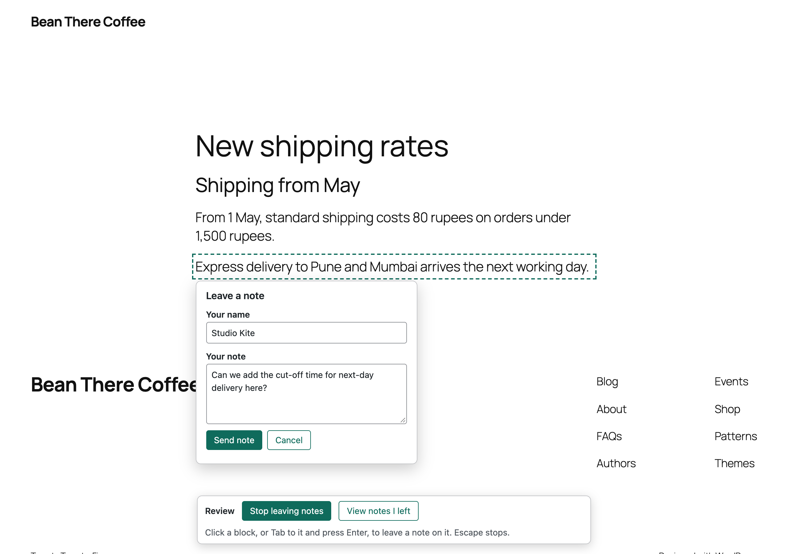
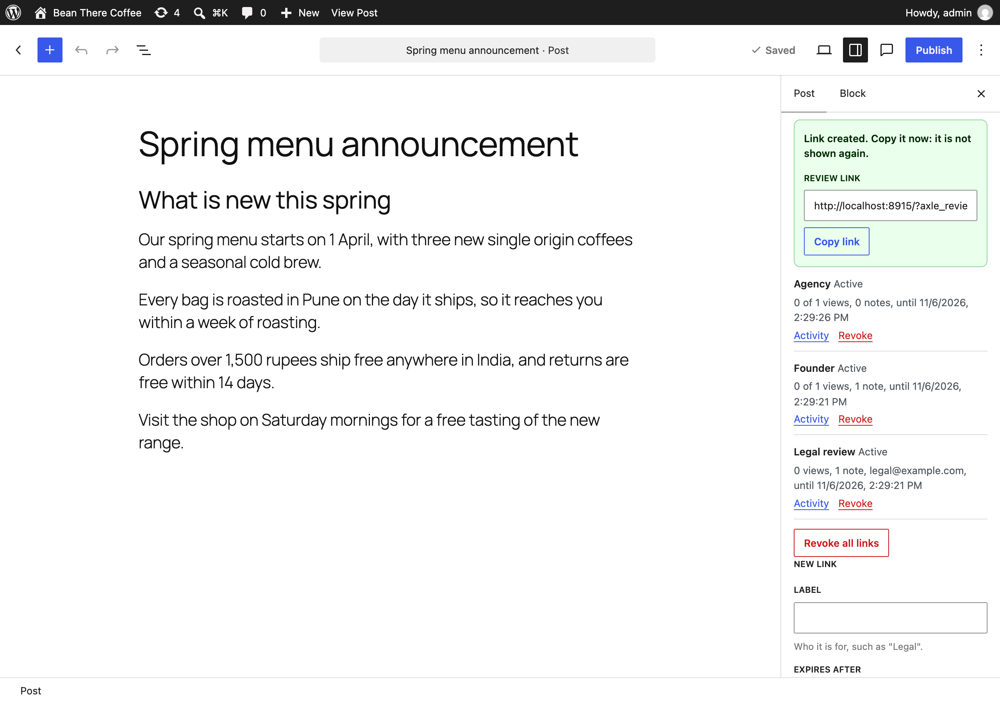
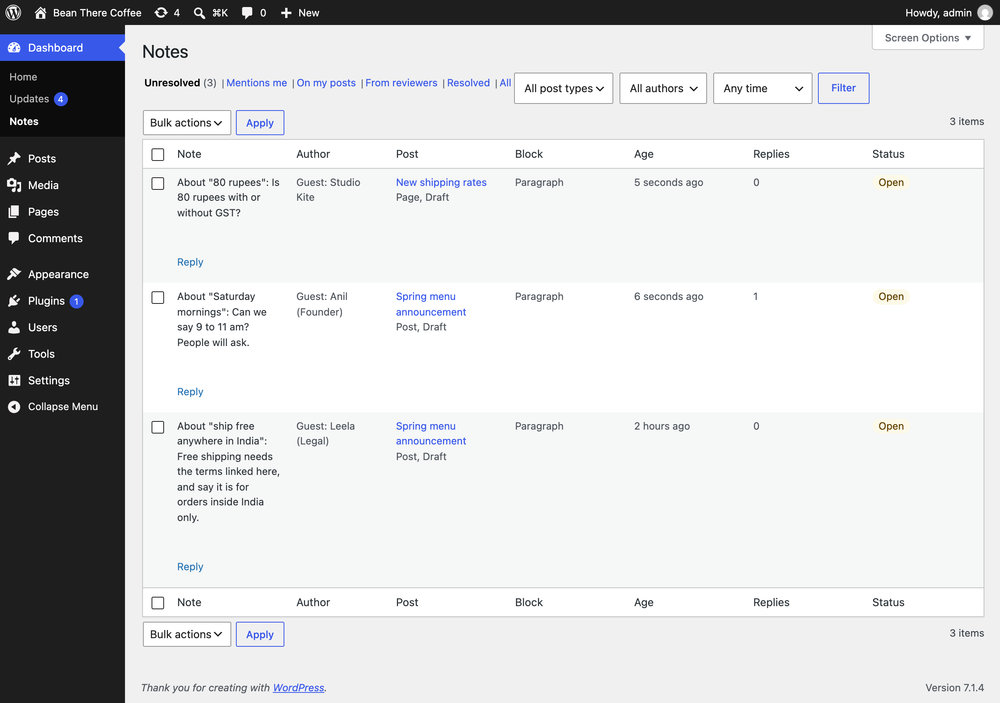
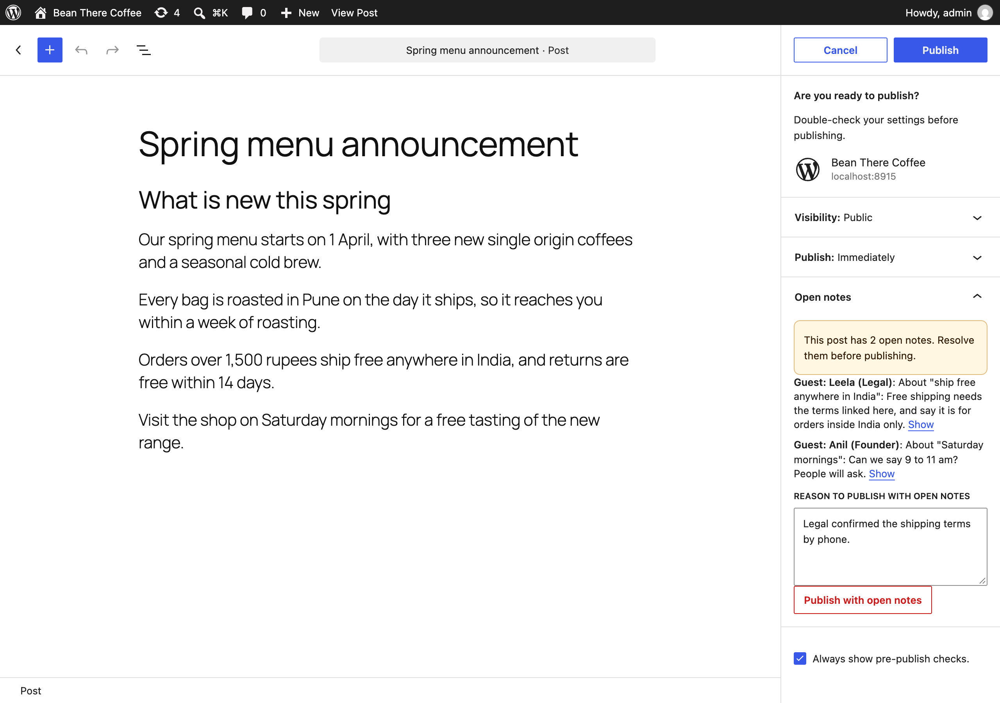
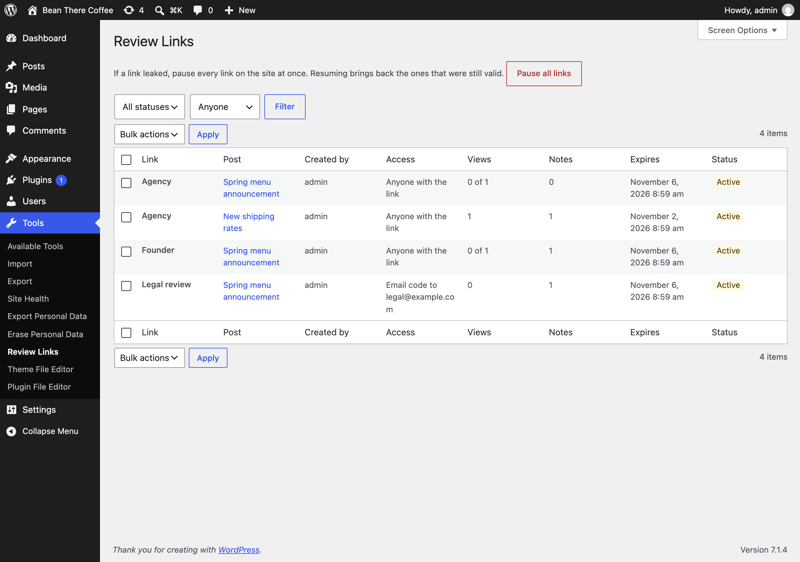
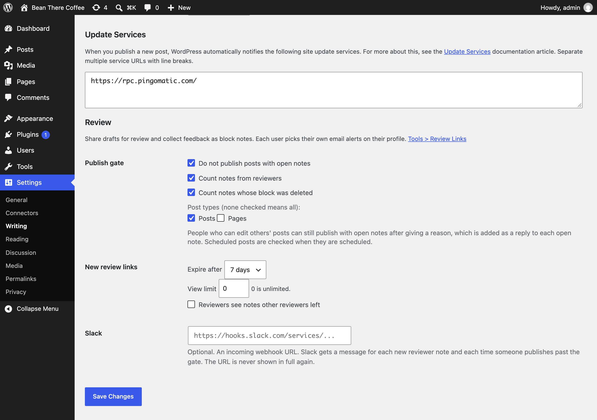

<h1 align="center">Axle Review</h1>

<p align="center">
  <a href="https://playground.wordpress.net/?blueprint-url=https://raw.githubusercontent.com/aryanjasala/axle-review/main/blueprint.json"></a>
  <a href="https://github.com/aryanjasala/axle-review/releases/latest"></a>
  
  
  <a href="LICENSE.md"></a>
  <br>
  <a href="https://github.com/aryanjasala/axle-review/actions/workflows/phpcs.yml"></a>
  <a href="https://github.com/aryanjasala/axle-review/actions/workflows/phpstan.yml"></a>
  <a href="https://github.com/aryanjasala/axle-review/actions/workflows/unit-tests.yml"></a>
  <a href="https://github.com/aryanjasala/axle-review/actions/workflows/e2e-tests.yml"></a>
  <a href="https://github.com/aryanjasala/axle-review/actions/workflows/plugin-check.yml"></a>
</p>

<p align="center">Share drafts through private links. Reviewers without an account leave feedback that lands as block Notes, right on the block they meant.</p>

<p align="center">
  
</p>

---

WordPress 6.9 added Notes: comments on blocks that editors reply to and resolve. But only people with an account can see a draft, and only people who can edit it can leave a note. Clients, legal teams and outside experts usually have neither. Draft link plugins let them read the draft, and feedback plugins keep comments in a second system your editors have to check as well. Axle Review closes the gap: a reviewer opens a private link, clicks a block and writes a note, and it becomes a normal core Note on that block. A site-wide Notes inbox, a resolve-before-publish gate and note alerts come with it.

> [!NOTE]
> Free and open source under the GPL. No pro version, no upsells, no ads in wp-admin, no tracking. And it stays that way.
>
> Part of Axle by AryanX, a family of plugins for running WordPress sites safely.

## Features

- **Review links** from the editor's "Share for review" panel, the posts list, WP-CLI or an ability: expiry from an hour to 30 days, view once or a few times, an optional password, and an optional email lock with a one-time code. Only a hash of the link is stored
- **Activity per link**: when it was opened, the browser family and how many notes came through it. Revoke one link, all of a post's links, or **pause every link** at once after a leak
- **Links die on their own** when the post is published, made private or trashed, and when the person who made them is deleted
- **Notes on blocks for people without an account**: the reviewer clicks a block (or tabs to it), writes a note, and it is saved as a core Note on that block. Selected text travels as a quote. Works on phones
- **Safe with an editor open**: the note shows up on its block in the open editor within seconds, and saving the older copy does not drop it
- **Reviewers see their own threads** and your replies on their next visit, never your editors' notes, and other reviewers' only if you allow it per link
- **Dashboard > Notes**: every note on the site. Unresolved, Mentions me (7.1+), On my posts, From reviewers, Resolved, All. Reply, resolve and reopen from the list, bulk resolve, and a Notes column on the posts list
- **Publish gate** (off by default): a post with open notes cannot be published or scheduled. Editors can publish anyway with a reason, which goes on each open note
- **Alerts**: instant email, an hourly or daily digest, or nothing, per user, for reviewer notes and replies to your notes. Optional Slack webhook
- **Abilities** so an AI agent can read notes, leave notes on blocks and check publish readiness; **WP-CLI** for everything; **privacy** export and erase; a **Site Health** check that spots page caches serving review pages

## Install

1. Download `axle-review.zip` from the [latest release](https://github.com/aryanjasala/axle-review/releases/latest).
2. In WordPress, go to **Plugins > Add New Plugin > Upload Plugin**, choose the zip and activate it.

Or with WP-CLI:

```sh
wp plugin install https://github.com/aryanjasala/axle-review/releases/latest/download/axle-review.zip --activate
```

Needs WordPress 6.9+ and PHP 7.4+. To try it first, the **Try in WordPress Playground** badge opens a throwaway WordPress in your browser with the plugin and some demo content.

## Quick look

Share a draft with someone outside the site, locked to their email address:

```sh
wp axle-review link create 42 --label="Legal" --expires=3d --email=legal@example.com --send-to=legal@example.com
```

They open the link, get a code by email, click the paragraph they mean and write a note. It lands as a core Note on that block:

```sh
wp axle-review notes list --guests
wp axle-review notes resolve 128 --user=maria
wp axle-review gate check 42   # exits 1 while open notes would hold publishing back
```

## Screenshots

<table>
  <tr>
    <td width="50%" valign="top"><br><sub>The "Share for review" panel in the editor: links with their views and notes, and a new link</sub></td>
    <td width="50%" valign="top"> Notes: every open note, with reply, resolve and reopen"><br><sub>Dashboard > Notes: every open note, with reply, resolve and reopen</sub></td>
  </tr>
  <tr>
    <td width="50%" valign="top"><br><sub>The editor before publishing, with the gate holding back a post that has open notes</sub></td>
    <td width="50%" valign="top"> Review Links: every link on the site, with the pause button"><br><sub>Tools > Review Links: every link on the site, with the pause button</sub></td>
  </tr>
  <tr>
    <td width="50%" valign="top"> Writing > Review: the publish gate, link defaults and Slack"><br><sub>Settings > Writing > Review: the publish gate, link defaults and Slack</sub></td>
  </tr>
</table>

## Documentation

| Doc | What it covers |
| --- | --- |
| [Reference](docs/REFERENCE.md) | Links, the review page, how reviewer notes become core Notes, the inbox, the gate, alerts, hooks, abilities, REST, WP-CLI, data and privacy |
| [Development](docs/DEVELOPMENT.md) | Local setup, commands and tests |
| [Contributing](docs/CONTRIBUTING.md) | Pull requests, required checks and PR titles |
| [Releasing](docs/RELEASING.md) | How merged pull requests become releases |
| [Security](docs/SECURITY.md) | Reporting a vulnerability |
| [readme.txt](readme.txt) | What WordPress.org shows, with the FAQ and changelog |

## Project structure

```
axle-review.php           plugin header and PSR-4 autoloader
uninstall.php             removes tables, options and meta
src/
├── Plugin.php            creates the services
├── Requirements.php      the WordPress 6.9 check
├── Schema.php            tables and schedules
├── Settings.php          settings, defaults and capability filters
├── Links.php             the links table
├── Events.php            link activity
├── Access.php            sessions, email codes, passwords, lockouts
├── Anchor.php            block paths, fingerprints and noteId
├── Notes.php             core Notes: guest notes, resolve, queries
├── Attacher.php          puts reviewer notes on their block
├── Gate.php              the publish gate
├── Alerts.php            email, digests and Slack
├── Lifecycle.php         what ends links, clean-up
├── Privacy.php           export, erase and policy text
├── Abilities.php         abilities for agents
├── Frontend/ReviewView.php  the review page and its gates
├── Rest/                 guest and editor routes
├── Admin/                inbox, links, settings, profile, editor assets
├── Health/SiteHealth.php the Site Health check
└── Cli/                  wp axle-review
assets/                   editor, review page and admin scripts and styles
tests/
├── Unit/                 PHPUnit with Brain Monkey
└── e2e/                  Playwright specs, fixture and the Docker site
.wordpress-org/           screenshots and brand assets
docs/                     reference, development, contributing, releasing
```

## More free plugins

Small plugins that each fill one gap in WordPress, all free with no pro version:

| | Plugin | What it does |
| --- | --- | --- |
|  | [Page Template Usage](https://github.com/aryanjasala/page-template-usage) | See which template every page uses, and fix the pages on a missing template |
|  | [Staging Guard](https://github.com/aryanjasala/staging-guard) | Stops staging copies from emailing real people or getting indexed |
|  | [Category & Tag Trash](https://github.com/aryanjasala/category-tag-trash) | A trash for categories, tags and custom terms, with undo and full restore |
|  | [Axle Read-Only Mode](https://github.com/aryanjasala/axle-read-only-mode) | Read-only mode for WordPress during migrations and deploys |
|  | [Axle Block Restore](https://github.com/aryanjasala/axle-block-restore) | Restore a single block from an old revision, not the whole post |
|  | [Activity Log with Undo](https://github.com/aryanjasala/activity-log-with-undo) | An activity log where every change you can reverse has an Undo button |
|  | [Agent Governance](https://github.com/aryanjasala/agent-governance) | Hold risky AI agent calls for approval, preview what they change, and roll back a session |
|  | [Block Doctor](https://github.com/aryanjasala/block-doctor) | Scan the whole site for invalid and broken blocks and fix them in bulk, with undo |
|  | [Block Theme Ops](https://github.com/aryanjasala/block-theme-ops) | Find Site Editor changes that override your theme files, see the diff, reset them or send them to Git |
|  | [Role Right-Sizer](https://github.com/aryanjasala/role-right-sizer) | Recommends the smallest role each user needs, from what they actually do |
|  | [Update Rehearsal](https://github.com/aryanjasala/update-rehearsal) | Try plugin, theme, core and PHP updates on a disposable copy of your site in WordPress Playground first |
|  | [User Session Manager](https://github.com/aryanjasala/user-session-manager) | See every device signed in, sign out one, and limit sessions per role |

## License

Copyright Aryan Jasala. Licensed under [GPL-2.0-or-later](LICENSE.md).
